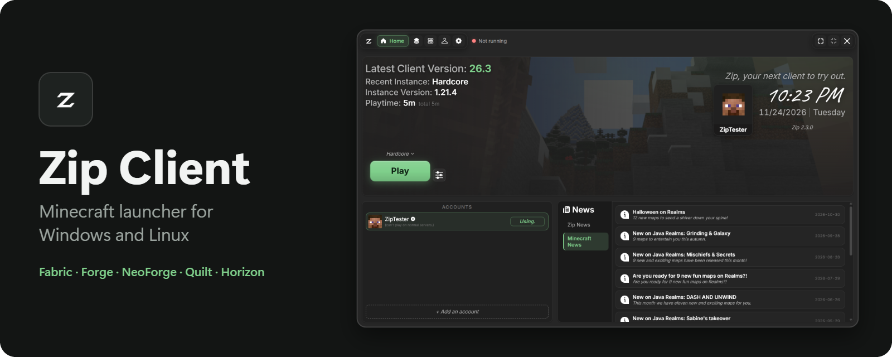
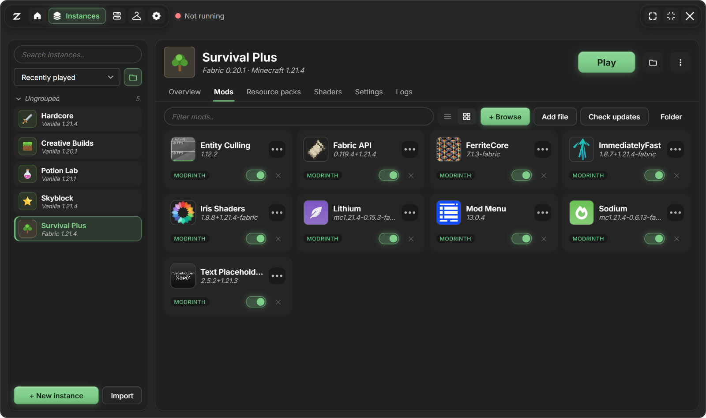
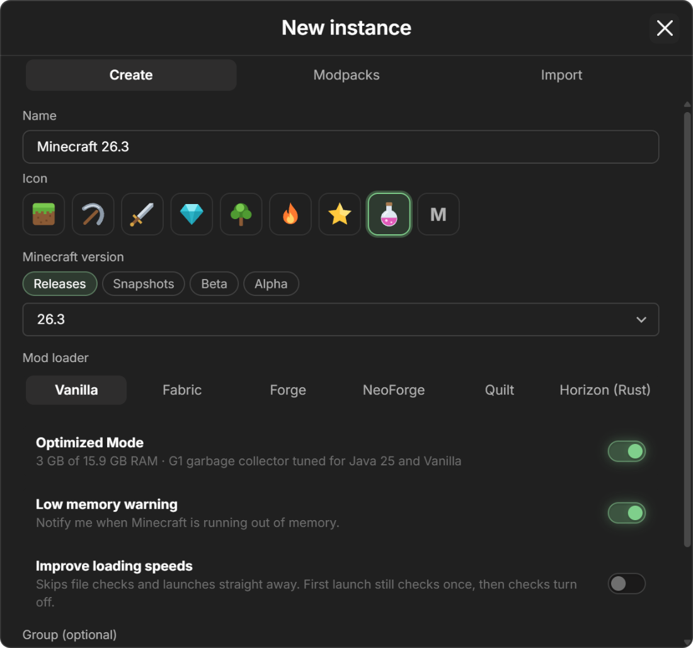
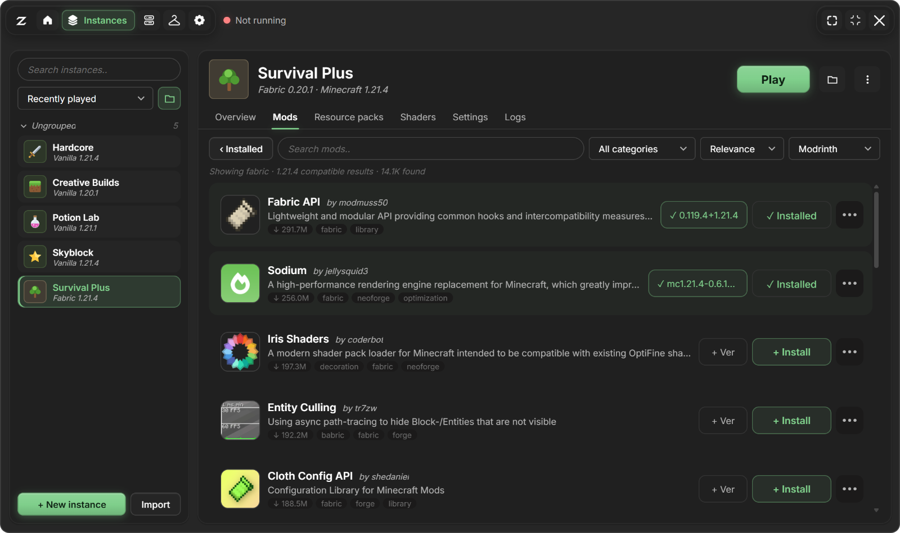
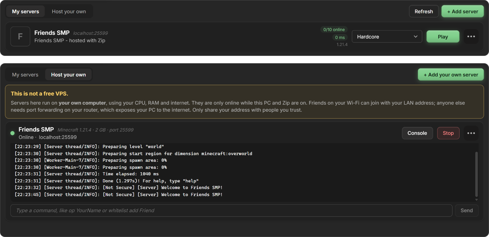
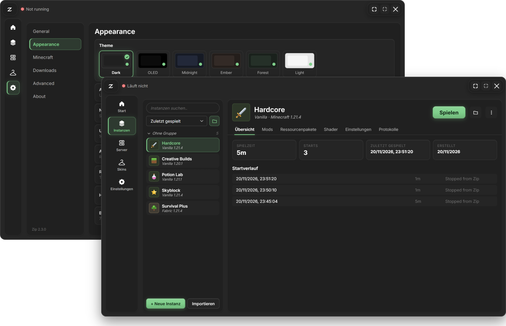

<p align="center">
  
</p>

<p align="center">
  <a href="https://zipclient.lol">Website</a> ·
  <a href="https://discord.gg/WrbbbhdFXT">Discord</a> ·
  <a href="https://github.com/sc0t6/zipclient/releases/latest">Download</a> ·
  <a href="#building-from-source">Build from source</a> ·
  <a href="#code-map">Code map</a>
</p>

Zip is a Minecraft launcher for Windows and Linux, built with Tauri 2, Rust and Vue 3. It installs every Minecraft version Mojang publishes (releases, snapshots, beta and alpha) with Vanilla, Fabric, Forge, NeoForge, Quilt or Horizon, keeps each setup in its own instance, installs mods from Modrinth and CurseForge, and can host a Minecraft server on your own PC.

Java is not needed on the player's machine. Zip downloads the runtime Mojang specifies for each Minecraft version and checks every file by hash.

## Download

| Platform | File | Notes |
|---|---|---|
| Windows 10/11 x64 | [`zip-setup-x64.exe`](https://github.com/sc0t6/zipclient/releases/latest/download/zip-setup-x64.exe) | Per-user installer. Updates itself. |
| Windows 10/11 x64 | [`zip-setup-x64.msi`](https://github.com/sc0t6/zipclient/releases/latest/download/zip-setup-x64.msi) | For managed machines and `msiexec` deployment. |
| Windows 10/11 x64 | [`zip-portable-x64.exe`](https://github.com/sc0t6/zipclient/releases/latest/download/zip-portable-x64.exe) | Runs without installing. |
| Linux x86_64 | `Zip-Launcher-x86_64.AppImage` | Runs on most distributions. `chmod +x`, then run it. |
| Debian / Ubuntu | `Zip-Launcher-amd64.deb` | `sudo apt install ./Zip-Launcher-amd64.deb` |
| Linux x86_64 | `Zip-Launcher-x86_64.flatpak` | `flatpak install --user Zip-Launcher-x86_64.flatpak` |
| Linux x86_64 | `Zip-Launcher-Portable-linux-x64.tar.gz` | Binary plus a `ZipData` folder that holds everything. |

The Linux packages are attached to the [2.1 release](https://github.com/sc0t6/zipclient/releases/tag/SystemSupportRelease) until the next Linux build. `SHA256SUMS.txt` on each release lists the checksums.

## Features

### Instances



Every instance has its own Minecraft version, loader, mods, Java, memory settings and game folder. Instances can be duplicated, exported as a `.zip`, repaired (every file is re-checked by hash) and grouped. Each one gets an icon: one of 8 built-in icons, the first letter of its name, or your own PNG or JPEG.



- **Optimized Mode** reads the Java version the Minecraft version needs, the loader and the computer's RAM, then sets memory (leaving at least 4 GB for the system) and G1 garbage-collector arguments.
- **Low memory warning** logs garbage collection and warns when the heap stays above 90% after three collections, or at once on `OutOfMemoryError`.
- **Improve loading speeds** skips file checks on launch. The first launch still checks everything once; after that Zip starts the game from the installed files. If the version files or the Java runtime are missing, it falls back to the full check; for anything else, use Repair installation. Changing the version or loader resets it.

### Mods, resource packs and shaders



- Search Modrinth, or CurseForge when the build has an API key. Results are filtered to the instance's Minecraft version and loader.
- Install installs required dependencies too. **+ Ver** picks a specific version; an installed mod shows its version there.
- Installed content shows as a list or a grid. Modrinth and Horizon updates are checked when the tab opens, and each outdated mod gets an Update button.
- Mods added from a file show their real name, version and icon, read from `fabric.mod.json`, `quilt.mod.json`, `mods.toml`, `neoforge.mods.toml` or `mcmod.info`. Resource packs show their `pack.png`.
- The list refreshes when you come back to the window, so files added or restored in Explorer show up.

### Modpacks

Modpacks install from Modrinth inside Zip, or import from a file: Modrinth `.mrpack`, CurseForge `.zip`, Prism Launcher `.zip` and Zip's own export. Drop the file on the Import tab or pick it with the file dialog. Imported packs keep their icon when the archive contains one; otherwise Zip looks the pack up on Modrinth or CurseForge.

### Servers



**My servers** pings each saved server and shows its MOTD, player count, version and latency. Addresses that use DNS SRV records work, and so do servers older than Minecraft 1.7. Pick an instance and press Play to join directly (Quick Play on 1.20 and newer, `--server` on older versions). Saved servers are also written into the multiplayer list (`servers.dat`) of every instance.

**Host your own** downloads the official server jar from Mojang, picks the right Java and runs the server on your PC with a live console. Creating one requires accepting the Minecraft EULA. These servers are not cloud hosting: they run only while your PC and Zip are on, and players outside your network need port forwarding on your router.

### Customization



Six themes (Dark, OLED, Midnight, Ember, Forest, Light), any accent color, UI scale from 75% to 150%, and three navigation layouts: top bar, sidebar, or sidebar without names. The interface is available in English, Español, Português (Brasil), Deutsch, Français, Polski and Русский.

### Horizon (Minecraft in Rust)

Instances can use the **Horizon (Rust)** loader: [Horizon](https://github.com/horizon-rust/horizon) is an unofficial open-source rewrite of Minecraft: Java Edition in Rust (MIT).

- Zip downloads the Windows or Linux build from Horizon's `nightly` GitHub release and refuses it unless `SHA256SUMS.sig` verifies against Horizon's Ed25519 release key (`horizon.rs`, `RELEASE_KEYS`) and the archive matches `SHA256SUMS`.
- It installs the pinned Minecraft version (from `research-lock.json`), downloads the matching server jar and Java 25, and runs `horizon-prepare` once to build Horizon's resources. Updates re-prepare automatically.
- The game starts natively without Java. Microsoft accounts are passed with `--session-stdin`, so the token never touches disk; offline profiles use `--name`.
- Mods come from [horizon-mods](https://github.com/horizon-rust/horizon-mods) (its `index.json`), checked against each version's SHA-256 and the revoked list. Content mods (`.hmod`) install into `horizon-mods/`. Native mods (`.hnmod`) have to be compiled into the game by the Horizon launcher, so Zip lists them but cannot install them.

### Accounts and skins

Microsoft accounts sign in with the device code flow: Zip shows a code, you enter it at microsoft.com/link, and Zip never sees your password. Offline profiles work for singleplayer and offline-mode servers and are marked as such. The Skins page keeps a local skin library and uploads skins to your Minecraft profile.

## Privacy

Zip has no telemetry, analytics or crash upload. It contacts only the services a feature needs: Mojang and Microsoft (game files, sign-in), Modrinth and CurseForge (content), Adoptium (Java fallback), GitHub (Horizon, Zip news and updates) and the Minecraft servers you add.

## Requirements

| What | Version |
|---|---|
| Windows | 10 or 11, x64 |
| WebView2 Runtime | Preinstalled on Windows 11 and current Windows 10. The installers download it when missing. |
| Linux | x86_64. The AppImage and Flatpak bring their own libraries; the `.deb` and portable build need WebKitGTK 4.1 and GTK 3 (Ubuntu 22.04+, Debian 12+, Fedora 38+, Arch). |
| Node.js | 20+ (development only) |
| Rust | stable; MSVC toolchain on Windows (development only) |
| Visual Studio Build Tools | "Desktop development with C++" (Windows development only) |
| Linux build packages | `build-essential libwebkit2gtk-4.1-dev libgtk-3-dev librsvg2-dev libxdo-dev libssl-dev patchelf` (Linux development only) |

If a Mojang Java runtime cannot start on Windows (for example the Java 8u51 build on Windows 11 25H2), Zip falls back to Eclipse Temurin from the Adoptium API, verified by SHA-256. On Linux, Zip also finds Java installed in `/usr/lib/jvm`, `/usr/lib64/jvm`, `/usr/java` and `/opt`.

## Building from source

```bash
npm install
npm run tauri dev
```

Rust unit tests:

```bash
cd src-tauri
cargo test
```

End-to-end install and launch test. It downloads real game files, starts Minecraft with an offline profile and stops it again:

```bash
cd src-tauri
ZIP_E2E_CASES="vanilla:1.21.1,fabric:1.21.1,quilt:1.21.1,forge:1.20.1,neoforge:1.21.1" cargo test install_and_launch_loaders -- --ignored --nocapture
```

`ZIP_E2E_DIR` selects the data folder for that test (default: the system temp folder plus `zip-e2e`). On a Linux machine without a desktop, wrap the command in `xvfb-run -a`.

### Release builds

```bash
npm run release
```

The script runs `tauri build` for the current OS and copies the packages into `release/`. Files from the other OS already in `release/` are kept. On Windows it produces `zip-setup-x64.exe` (NSIS, per user), `zip-setup-x64.msi` (WiX) and `zip-portable-x64.exe`. On Linux it produces the AppImage, the `.deb` and the portable `.tar.gz`; `bash scripts/flatpak.sh` builds the Flatpak afterwards (needs `flatpak` and `flatpak-builder`).

From Windows, the Linux packages can be built in WSL (Ubuntu 24.04): `bash scripts/wsl-sync.sh` copies the project to `~/zip` (edit the `SRC` path in the script first), then run `npm ci && npm run release && bash scripts/flatpak.sh` there and copy `~/zip/release/*` back into `release/`.

`SHA256SUMS.txt` is written next to the packages. When the updater signing key is available, `.sig` files are produced, and when `ZIP_RELEASE_BASE_URL` is set, a `latest.json` update manifest is generated. Build-time variables are listed in `config/build.env.example`.

### Publishing a release

1. Bump `version` in `src-tauri/tauri.conf.json`, `src-tauri/Cargo.toml` and `package.json`.
2. Run `npm run release` on Linux (or in WSL) and `bash scripts/flatpak.sh`, copy the Linux files into the Windows `release/` folder, then run `npm run release` on Windows. Each run adds its platforms to `release/latest.json` for the same version.
3. Create a GitHub release, mark it as the latest, and upload every file in `release/` with its name unchanged, including `latest.json`.

Zip checks `releases/latest/download/latest.json` at startup. When the version there is newer, it offers the update and installs the signed package that matches how Zip was installed (NSIS, MSI, AppImage or `.deb`). Portable copies and the Flatpak open the release page instead.

### Microsoft sign-in

Microsoft sign-in uses the OAuth 2.0 device code flow (`login.microsoftonline.com/consumers`), then Xbox Live, XSTS and `api.minecraftservices.com`. You need your own Azure application:

1. Register an application in the Azure portal (Microsoft Entra ID > App registrations). Supported account types: personal Microsoft accounts.
2. Under Authentication, enable "Allow public client flows".
3. Mojang must approve new client IDs for Minecraft services. Submit the application through Mojang's form for third-party launchers; until it is approved, `login_with_xbox` returns HTTP 403.
4. Put the client ID in `config/build.env` as `ZIP_MS_CLIENT_ID`. `build.rs` bakes it into the binary. `config/build.env` is git-ignored.

On Windows, refresh tokens and Minecraft access tokens are encrypted with DPAPI (current user) before they are written to `accounts.json`. On Linux, `accounts.json` is written with mode `0600`. Tokens never reach the UI and are redacted from launch logs.

### CurseForge

CurseForge's API needs a key from <https://console.curseforge.com>. Put it in `config/build.env` as `ZIP_CURSEFORGE_KEY`; it is compiled into the release. Anyone with the binary can extract an embedded key, so use a key issued for this launcher only. Without a key, Modrinth browsing and `.mrpack` imports work, CurseForge `.zip` modpacks without mod files import, and CurseForge packs that list mod files stop with a message asking for a key. Files whose authors disabled third-party downloads are reported by name and never substituted.

### Updates

Zip checks a configurable HTTPS endpoint for a Tauri update manifest (`latest.json`). Packages must be signed with the minisign key whose public half is in `src-tauri/tauri.conf.json` (`plugins.updater.pubkey`); the updater plugin rejects anything else. Set the endpoint with `ZIP_UPDATE_ENDPOINT` at build time or in Settings > General. The private signing key is not in this repository: `npm run release` reads it from `TAURI_SIGNING_PRIVATE_KEY_PATH` or `~/.tauri/zip-updater.key`. To rotate keys, run `npx tauri signer generate -w <path>` and replace `pubkey`.

The Home page has **Zip News** (the GitHub releases of `ZIP_GITHUB_REPO`) and **Minecraft News** (Mojang's launcher feed).

## Data locations

The portable executable and the installed app share one data folder, so moving the portable `.exe` never loses settings, accounts or instances:

| Build | Data folder |
|---|---|
| Windows | `%APPDATA%\Zip` |
| Linux (AppImage, `.deb`) | `~/.local/share/Zip` (or `$XDG_DATA_HOME/Zip`) |
| Flatpak | `~/.var/app/dev.ziplauncher.app/data/Zip` |

For a self-contained copy (a USB stick, for example), create an empty folder named `ZipData` or a file named `zip-portable.txt` next to the executable. Zip then keeps everything in `ZipData`. `ZIP_DATA_DIR` overrides the data folder for development and testing.

| Path | Contents |
|---|---|
| `settings.json` | Launcher settings (schema-versioned, migrated automatically) |
| `accounts.json` | Accounts with encrypted secrets |
| `servers.json` | Saved servers from My servers |
| `instances/<id>/instance.json` | Instance settings, icon, playtime and launch history |
| `instances/<id>/minecraft/` | The instance's game folder (mods, saves, configs, `servers.dat`) |
| `instances/<id>/minecraft/.zip-content.json` | Which installed files came from Modrinth, CurseForge or Horizon |
| `instances/<id>/launcher-logs/` | The last 10 launch logs |
| `hosted-servers/<id>/` | A hosted server: `zip-server.json`, `server.jar`, `eula.txt`, the world |
| `minecraft/` | Shared libraries, assets, versions and Java runtimes |
| `cache/` | Bounded cache (metadata, skins, mod icons, temporary packs) |
| `skins/` | Local skin library |
| `logs/launcher.log` | Launcher log |
| `zipclient/packages/` | Zip Client packages (see below) |

The instances folder and the game files folder can be moved in Settings.

## Code map

The source has no comments, so this section is the guide. The Rust side does all file, network and process work; the Vue side calls it through Tauri commands and listens to events.

### Backend (`src-tauri/src`)

| File | What it does |
|---|---|
| `lib.rs` | Registers every Tauri command (`#[tauri::command]`) and the app setup. Start here to find which module handles a UI action. |
| `game.rs` | Launch flow: `prepare` installs or reuses files, picks Java, builds arguments; `prepare_and_spawn` starts the process, pumps logs, detects "running", records playtime and crashes. `quick_prepare` is the Improve loading speeds path. `join_args` adds Quick Play or `--server`. |
| `minecraft/install.rs` | Version JSON, client jar, libraries, assets and natives, all through verified downloads. |
| `minecraft/loaders.rs`, `minecraft/forge.rs` | Fabric, Quilt, Forge and NeoForge installation, including Forge installer processors. |
| `minecraft/java.rs` | Finds Java, installs Mojang runtimes, falls back to Temurin. `quick_select` reuses an installed runtime without network calls. |
| `minecraft/version.rs`, `minecraft/launch.rs` | Version JSON merging and rules, launch argument building. |
| `instances.rs` | Instance files, create, update (`InstancePatch`), duplicate, export, icons. |
| `content.rs` | Modrinth, CurseForge and Horizon search, install with dependencies, update checks, enable and disable, local mod metadata and icons. The per-instance index is `.zip-content.json`. |
| `modpack.rs` | Modpack import for `.mrpack`, CurseForge, Prism and Zip exports, plus pack icons. |
| `servers.rs` | Saved servers, server list ping (with SRV lookup and the pre-1.7 protocol), `servers.dat` sync, hosted servers (download, start, console, stop). |
| `nbt.rs` | Minimal NBT reader and writer used for `servers.dat`. |
| `horizon.rs` | Horizon release verification, preparation and its mod index. |
| `auth.rs` | Microsoft device code flow, Xbox, XSTS and Minecraft tokens, offline profiles, token storage. |
| `net.rs` | Shared HTTP client, parallel verified downloads with retries, cached JSON, cache pruning. |
| `storage.rs` | Data folder, settings schema, validation and migration, atomic file writes. |
| `skins.rs`, `news.rs`, `optimize.rs`, `updater.rs`, `zipclient.rs`, `platform.rs`, `diagnostics.rs`, `tasks.rs` | Skins, news feeds, Optimized Mode presets, signed updates, Zip Client packages, OS helpers, logging, progress reporting. |

Events sent to the UI: `game-state`, `game-log`, `game-warning`, `task-progress`, `server-state`, `server-log`, `auth-event`, `close-requested`.

### Frontend (`src`)

| Path | What it does |
|---|---|
| `api.ts` | Every Tauri command as a typed function, plus the shared types. |
| `stores/app.ts` | Instances, accounts, running games, progress, current page; listens to backend events. |
| `stores/settings.ts` | Loads and saves settings, applies theme, accent, scale and language. |
| `pages/` | Home, Instances, Servers, Skins, Settings and the first-run Setup. |
| `components/` | Dialogs and building blocks: `ContentManager` (mods, packs, shaders), `CreateInstance`, `InstanceSettings`, `KebabMenu`, `IconPicker`, `SideNav`, `VirtualList` and others. |
| `i18n.ts`, `locales.ts` | Translations. Each row in `locales.ts` is the English text followed by its translations; `i18n.ts` swaps matching text on screen. To add a language, add a column and an entry in `languages`. |
| `presets.ts`, `assets/instance-icons/` | The 8 built-in instance icons. |

## Zip Client package

Every instance has a "Use Zip Client" switch. It stays off and disabled until a valid package exists; Zip never fakes the client.

A package is a folder inside `zipclient/packages/` containing `zip-client.json`:

```json
{
  "id": "zip-client",
  "version": "1.0.0",
  "minecraft": ["1.21.1"],
  "loaders": ["fabric"],
  "files": [{ "source": "zip-client.jar", "target": "mods/zip-client.jar", "sha256": "<sha256 of the jar>" }]
}
```

Zip verifies every file's SHA-256, offers the switch only for compatible Minecraft and loader versions, copies the files into the instance's `mods` folder before launch, tracks exactly which files it placed (`.zip-client-state.json`) and removes only those when the switch is turned off or the package disappears. A missing or incompatible package never blocks launching. The newest valid package version wins.

## Website

`website/` is a static site with no cookies, analytics or external requests. `terms.html`, `privacy.html` and `disclaimer.html` are generated from `legal/legal.json` by `node website/build.mjs`, which also stamps the app version into the homepage. Zip shows the same documents in Settings > About and asks users to accept them during setup and whenever `legal.json`'s `version` changes.

## Troubleshooting

| Symptom | What to do |
|---|---|
| Linux: window does not open | Install WebKitGTK 4.1 (`libwebkit2gtk-4.1-0` on Debian/Ubuntu), or use the AppImage or Flatpak. On some NVIDIA setups `WEBKIT_DISABLE_DMABUF_RENDERER=1` helps. |
| Linux: Minecraft 1.12.2 or older crashes with `LinuxDisplay.getAvailableDisplayModes` | LWJGL 2 needs `xrandr` (`x11-xserver-utils` on Debian/Ubuntu, `xrandr` on Fedora and Arch). The Flatpak includes it. |
| Linux: Mojang's Java does not start | Install the Java version the error names (for example `openjdk-21-jre`) and pick it in Settings > Minecraft > Java. |
| Minecraft does not start | Open the instance's Logs tab. Launch logs are in `instances/<id>/launcher-logs`. Crash reports open from the crash notification. |
| Files missing or broken | Instance menu > Repair installation re-checks every file by hash and reruns loader installers. |
| A server shows as offline | Check the address and port. "Address not found" means DNS failed; "server is offline or the port is wrong" means nothing answered on that port. |
| Quick join opens the accessibility screen first | That is Minecraft's first-run screen on a new instance. Click through it; if the game does not join, open Multiplayer, where the server is already in the list. |
| Microsoft sign-in says "not available" | The build has no `ZIP_MS_CLIENT_ID`; rebuild with one. |
| Mods tab empty for a Vanilla instance | Switch the instance to Fabric, Forge, NeoForge or Quilt. |
| Need a bug report | Settings > Advanced > Copy diagnostics. |

## License

Copyright (C) 2026 Krizuvo.

Zip's source code is free software under the [GNU General Public License, version 3](LICENSE) (GPL-3.0-only). You may use, change and share it; if you distribute a modified version, you must publish its source under the same license. It comes without any warranty.

The license covers the code. The Zip name and logo stay with Krizuvo, so forks need their own name and logo. Third-party components keep their own licenses: Tauri (MIT/Apache-2.0), Vue, Pinia, skinview3d and three.js (MIT), the Inter and Caveat typefaces (SIL Open Font License 1.1), and the Rust crates listed in `src-tauri/Cargo.lock`. Minecraft is a trademark of Mojang AB; Zip is not affiliated with Mojang or Microsoft.
